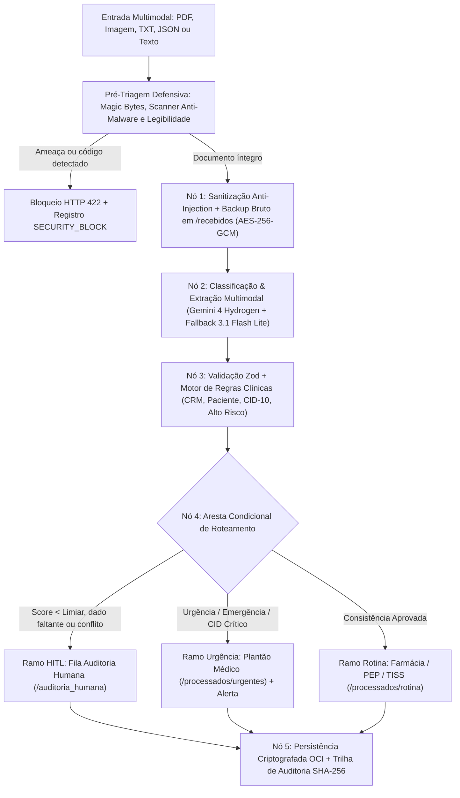
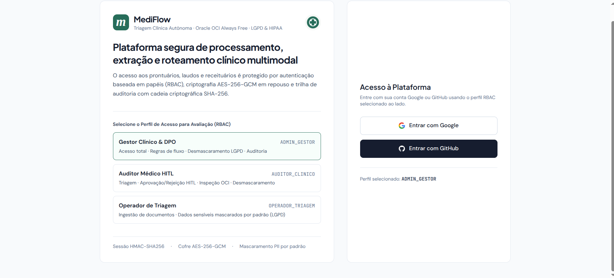
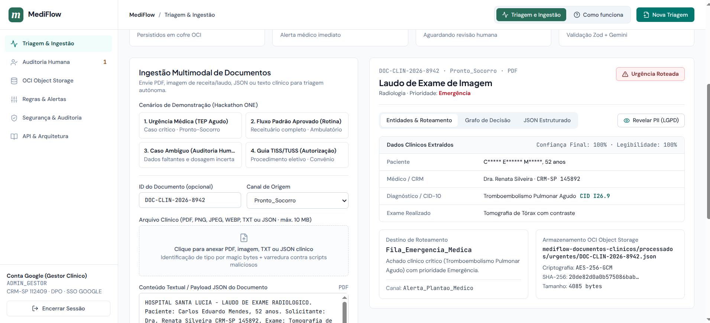
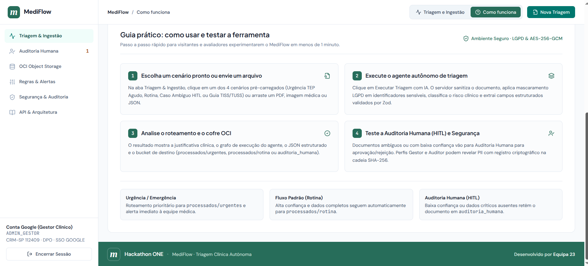
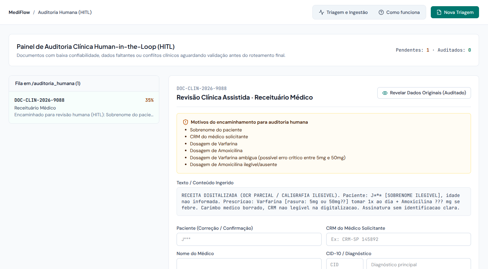
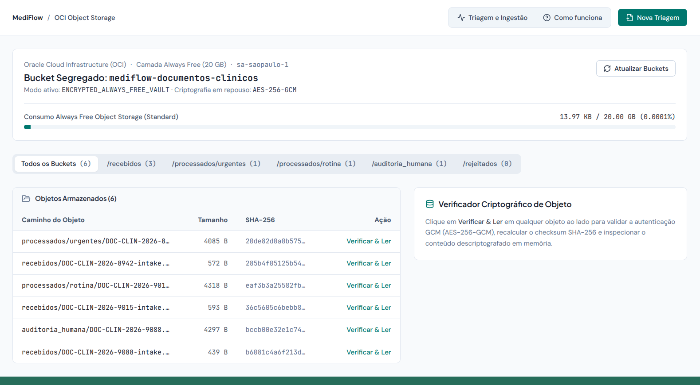
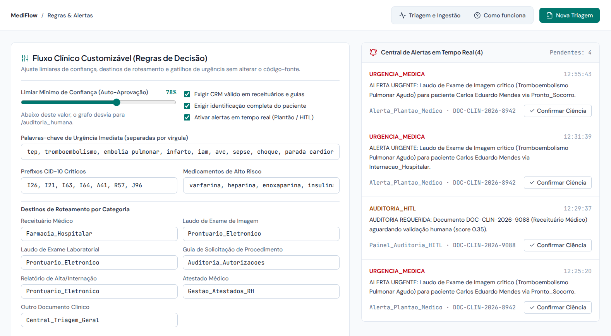
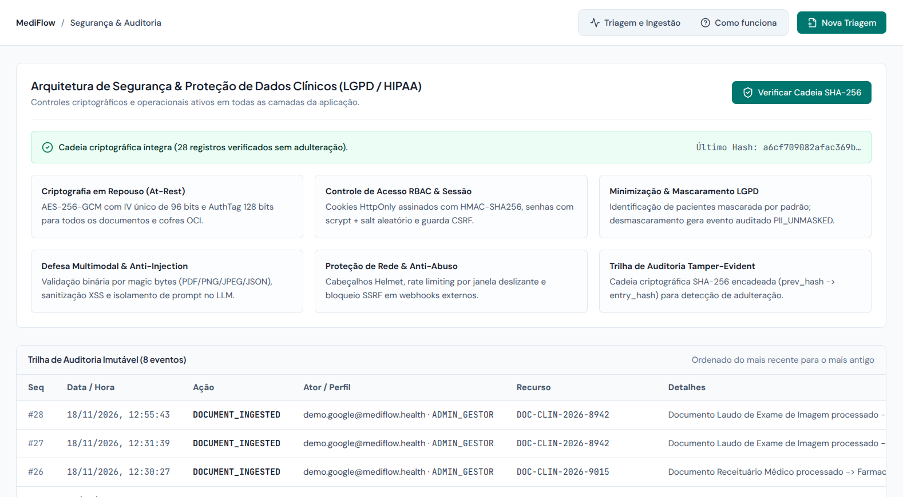
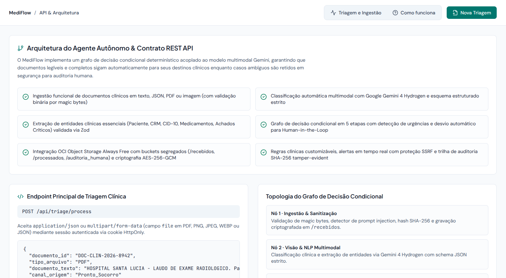

<div align="center">
  
  <h1>MediFlow — Triagem Clínica Autônoma</h1>
  <p>
    <strong>Agente multimodal de triagem, extração estruturada e roteamento seguro de documentos clínicos com arquitetura <em>Human-in-the-Loop</em> (HITL), criptografia AES-256-GCM e integração Oracle OCI Object Storage.</strong>
  </p>
  <p>
    <em>Projeto desenvolvido para o Hackathon ONE G10 (Oracle Next Education &amp; Alura) · Equipa 23</em>
  </p>
</div>

---

## Sumário

1. [O que é o MediFlow?](#o-que-é-o-mediflow)
2. [Funcionalidades Principais](#funcionalidades-principais)
3. [Como Funciona (Grafo de Decisão Autônomo)](#como-funciona-grafo-de-decisão-autônomo)
4. [Visão das Telas do Sistema](#visão-das-telas-do-sistema)
5. [Segurança, Privacidade e Conformidade (LGPD / HIPAA)](#segurança-privacidade-e-conformidade-lgpd--hipaa)
6. [Arquitetura e Estrutura do Repositório](#arquitetura-e-estrutura-do-repositório)
7. [Integração OCI Object Storage (Always Free)](#integração-oci-object-storage-always-free)
8. [Contrato da API REST](#contrato-da-api-rest)
9. [Como Executar Localmente](#como-executar-localmente)
10. [Deploy no Netlify & Pipeline GitHub](#deploy-no-netlify--pipeline-github)

---

## O que é o MediFlow?

O **MediFlow** é uma plataforma web full-stack voltada para **apoio à triagem documental em ambientes de saúde** (pronto-socorro, ambulatórios, recepção hospitalar e auditoria de convênios).

Em rotinas clínicas reais, documentos chegam de forma heterogênea — laudos em PDF, receitas fotografadas, guias TISS/TUSS em JSON e evoluções em texto livre — exigindo leitura rápida para identificar riscos urgentes sem abrir mão da rastreabilidade e da segurança de dados sensíveis.

O MediFlow resolve esse problema com um **agente clínico autônomo em 5 etapas** que:
1. **Inspeciona e valida** cada arquivo ou texto contra códigos maliciosos e tentativas de intrusão antes mesmo de acionar a IA.
2. **Classifica e extrai entidades clínicas** (paciente, médico solicitante, CRM, diagnóstico, CID-10, medicamentos de alto risco e achados críticos) utilizando IA multimodal (`@google/genai`).
3. **Audita consistência determinística** com schemas **Zod** e um motor configurável de regras hospitalares.
4. **Roteia automaticamente** para emergência ou fluxo padrão — ou **retém para revisão humana (HITL)** sempre que houver ambiguidade, baixa confiança ou dados críticos ausentes.
5. **Persiste com criptografia AES-256-GCM** em buckets segregados compatíveis com a **Oracle Cloud Infrastructure (OCI)**, mantendo sigilo LGPD por padrão e trilha de auditoria criptográfica `SHA-256`.

> **Princípio do projeto:** *Tecnologia que organiza. Gente que decide.* O agente estrutura e sinaliza prioridades para apoiar equipes médicas — a decisão clínica final permanece com profissionais de saúde.

---

## Funcionalidades Principais

- **Ingestão Multimodal Real**: Suporte a `PDF`, imagens (`PNG`, `JPEG`, `WEBP`), arquivos `.txt`, payloads `JSON` e entrada textual direta, além de **4 cenários de demonstração prontos** para avaliação imediata:
  1. **Urgência Médica (TEP Agudo)** → Roteado para `Fila_Emergencia_Medica` e `/processados/urgentes` com alerta imediato.
  2. **Fluxo Padrão (Receituário Completo)** → Aprovado automaticamente para `Farmacia_Hospitalar` e `/processados/rotina`.
  3. **Caso Ambíguo / Ilegível (HITL)** → Retido em `Fila_Auditoria_Humana` (`/auditoria_humana`) para correção e aprovação médica.
  4. **Guia TISS/TUSS (JSON Estruturado)** → Extraído e encaminhado para `Auditoria_Autorizacoes`.
- **Painel de Auditoria Humana (HITL)**: Fila dedicada para médicos auditores revisarem documentos sinalizados, revelarem dados mascarados com log auditado, corrigirem CRM/CID/dosagem e aprovarem ou rejeitarem o encaminhamento.
- **Explorador de Buckets OCI Object Storage**: Visualização por prefixos (`/recebidos`, `/processados/urgentes`, `/processados/rotina`, `/auditoria_humana`, `/rejeitados`), cota da camada *Always Free* (20 GB) e verificador criptográfico de integridade (`SHA-256` + `AES-256-GCM`).
- **Motor de Regras Clínicas Customizáveis & Alertas**: Ajuste em tempo real do limiar de confiança, palavras-chave de urgência, prefixos CID-10 críticos, medicamentos de alto risco, destinos por categoria e webhooks HTTPS protegidos contra SSRF.
- **Aba "Como funciona" no Topo**: Guia visual interativo pensado para visitantes e avaliadores testarem a ferramenta em menos de 1 minuto.

---

## Como Funciona (Grafo de Decisão Autônomo)

O pipeline de backend (`src/server/agentGraph.ts`) executa um **grafo determinístico de 5 nós com aresta condicional**:



### Detalhamento dos 5 Nós do Agente

| Nó | Etapa | Responsabilidade Técnica |
| --- | --- | --- |
| **Nó 1** | `ingest_and_sanitize` | Isola o conteúdo não confiável, detecta padrões residuais de *prompt injection*, calcula checksum `SHA-256` e grava o payload bruto cifrado em `/recebidos`. |
| **Nó 2** | `multimodal_classify_and_extract` | Envia o documento (texto ou anexo binário PDF/imagem em base64) ao **Gemini 4 Hydrogen** (`gemini-4-hydrogen` com timeout de 22s e fallback automático para `gemini-3.1-flash-lite`) exigindo saída JSON estrita. |
| **Nó 3** | `clinical_consistency_validator` | Valida o JSON com **Zod**, cruza regras ativas (CRM obrigatório, identificação do paciente, medicamentos de alto risco, CID-10 críticos e palavras-chave de urgência) e calcula o score final. |
| **Nó 4** | `conditional_routing_edge` | Seleciona deterministicamente o destino entre **Auditoria HITL**, **Emergência Médica** ou **Fluxo Padrão (Rotina)**. |
| **Nó 5** | `persist_oci_and_notify` | Persiste a decisão estruturada cifrada no bucket OCI correspondente, atualiza o repositório isolado do usuário e dispara alertas em tempo real (e webhook HTTPS se configurado). |

---

## Visão das Telas do Sistema

### 1. Autenticação Federada (Google / GitHub) e Seleção RBAC
Seleção clara de perfil de acesso (`ADMIN_GESTOR`, `AUDITOR_CLINICO` ou `OPERADOR_TRIAGEM`) com login via Google ou GitHub, sessão assinada `HMAC-SHA256` e zero exposição de credenciais fixas na tela.



### 2. Workspace Principal: Triagem & Ingestão Multimodal
Painel dividido com cenários prontos do Hackathon, upload validado por *magic bytes*, extração estruturada com mascaramento LGPD automático (`C***** E****** M*****`), destino de roteamento e resumo do objeto cifrado no OCI.



### 3. Guia Prático "Como funciona"
Acessível diretamente pela barra superior para orientar avaliadores e visitantes sobre os 4 passos de teste e os 3 ramos de decisão do agente.



### 4. Auditoria Humana (Human-in-the-Loop)
Documentos com caligrafia ilegível, dosagens conflitantes ou CRM ausente ficam retidos para revisão médica, com justificativa detalhada, edição assistida de campos e movimentação automática no OCI após aprovação ou rejeição.



### 5. OCI Object Storage & Verificador Criptográfico
Organização por prefixos (`/recebidos`, `/processados/urgentes`, `/processados/rotina`, `/auditoria_humana`, `/rejeitados`), acompanhamento da cota *Always Free* (20 GB) e validação em memória da tag `AES-256-GCM` e do hash `SHA-256`.



### 6. Regras Clínicas Customizáveis & Central de Alertas
Permite ao gestor ajustar o limiar mínimo de confiança, palavras-chave de urgência, CIDs críticos, destinos de roteamento e reconhecer alertas de plantão em tempo real.



### 7. Segurança, LGPD & Trilha de Auditoria Imutável
Exibe a postura criptográfica ativa e a cadeia encadeada de auditoria (`prev_hash` → `entry_hash`) com botão de verificação de integridade `SHA-256`.



### 8. API & Arquitetura do Agente
Documentação embutida do contrato REST (`POST /api/triage/process`) e da topologia do grafo de decisão condicional.



---

## Segurança, Privacidade e Conformidade (LGPD / HIPAA)

O MediFlow aplica defesa em profundidade (*Defense in Depth*) nas camadas de transporte, autenticação, validação de entradas, IA e persistência:

| Camada | Controle Implementado | Detalhe Técnico |
| --- | --- | --- |
| **Identidade & Sessão** | `HMAC-SHA256` + Cookies `HttpOnly` + OAuth `state` | Sessões stateless com TTL de 8h verificadas com `timingSafeEqual`; proteção contra CSRF nos callbacks Google/GitHub e nas rotas mutáveis (`csrfOriginGuard`). |
| **Isolamento Multiusuário** | **Anti-IDOR Estrito** | Cada login gera identidade isolada (`owner_id`). Consultas, objetos OCI, alertas e logs filtram estritamente pelo usuário autenticado. Parâmetros de troca pela URL (`?userId=`, `?ownerId=`, `?impersonate=`, etc.) e *path traversal* (`..`, `\`) retornam **HTTP 403** com log `SECURITY_BLOCK`. |
| **Segurança de Upload** | **Magic Bytes + Scanner Profundo** | Identifica o tipo real por assinatura binária (`%PDF-`, `PNG`, `JPEG`, `WEBP`, `TXT`, `JSON`). Bloqueia executáveis (`PE/EXE/DLL`, `ELF`, `ZIP/JAR`, shebang `#!`, `HTML/SVG/PHP`, `.py`, `.js`, `.sh`). Inspeciona dentro de PDFs (`/JavaScript`, `/JS`, `/OpenAction`, `/AA`, `/Launch`, `/EmbeddedFile`, `/XFA`) e dentro de imagens/TXT/JSON (XSS, Python `os/subprocess`, Shell, SQLi e Prompt Injection), informando o tipo detectado e a ameaça encontrada (**HTTP 422**). |
| **Sanitização de Texto** | Filtro Anti-Código & Legibilidade | Impede envio de código JavaScript, Python, Shell, SQLi, Prompt Injection, sintaxe de programação ou ruído aleatório no campo de texto antes de acionar o modelo Gemini. |
| **Privacidade (LGPD)** | Mascaramento por Padrão + RBAC | Nomes de pacientes, identificadores e CPFs vêm mascarados por padrão; somente `ADMIN_GESTOR` e `AUDITOR_CLINICO` podem revelar temporariamente em sessão gerando evento auditado `PII_UNMASKED`. |
| **Criptografia em Repouso** | `AES-256-GCM` | Todos os documentos, objetos OCI e alertas são cifrados com IV único de 96 bits e `authTag` de 128 bits antes da gravação. |
| **Auditoria & Rede** | Cadeia `SHA-256` + Anti-SSRF + CSP | Log encadeado *tamper-evident*, bloqueio de URLs internas/privadas em webhooks, *rate limiting* por janela deslizante e cabeçalhos `Helmet` + `netlify.toml` (HSTS, CSP, `nosniff`, `Permissions-Policy`). |

---

## Arquitetura e Estrutura do Repositório

Todo o código-fonte está comentado em **português** para facilitar leitura, manutenção e contribuição da comunidade lusófona.

```text
├── .github/
│   └── workflows/
│       └── ci-security.yml          # Pipeline GitHub Actions (lint, build, bundle Netlify e scan de segredos)
├── netlify/
│   └── functions/
│       └── api.ts                   # Adaptador serverless-http que expõe o backend Express no Netlify Functions
├── public/
│   └── assets/aistudio/             # Logos, ilustrações clínicas e capturas usadas na interface e no README
├── src/
│   ├── components/                  # Componentes React (Tailwind CSS + Lucide Icons)
│   │   ├── AgentGraphFlow.tsx       # Visualização nó a nó do grafo de decisão e ramos condicionais
│   │   ├── ApiDocsPanel.tsx         # Painel de arquitetura e contrato REST
│   │   ├── HowItWorksPanel.tsx      # Guia prático para visitantes ("Como funciona")
│   │   ├── HumanAuditPanel.tsx      # Bancada médica de auditoria HITL
│   │   ├── LoginScreen.tsx          # Login OAuth (Google / GitHub) + seleção de perfil RBAC
│   │   ├── OciStorageExplorer.tsx   # Explorador de buckets OCI e verificador SHA-256 / AES-256-GCM
│   │   ├── RulesAndAlertsPanel.tsx  # Editor de regras clínicas + central de alertas
│   │   ├── SecurityAuditPanel.tsx   # Postura de segurança + tabela de auditoria encadeada SHA-256
│   │   └── TriageWorkspace.tsx      # Tela principal de ingestão multimodal e resultados
│   ├── lib/
│   │   └── api.ts                   # Cliente HTTP tipado com suporte a cookies HttpOnly e fallback Bearer
│   ├── server/
│   │   ├── agentGraph.ts            # Orquestrador do grafo em 5 nós e integração @google/genai
│   │   ├── app.ts                   # Rotas Express, middlewares Anti-IDOR, CSRF, OAuth e upload Multer
│   │   ├── ociStorage.ts            # Gerenciamento de buckets OCI (cofre local cifrado + PAR / S3 v4)
│   │   ├── security.ts              # AES-256-GCM, HMAC, RBAC, LGPD, Magic Bytes, Malware Scanner e SHA-256
│   │   └── store.ts                 # Persistência cifrada em disco (.mediflow-vault ou /tmp em serverless)
│   ├── shared/
│   │   └── clinicalSchemas.ts       # Contratos TypeScript, schemas Zod e os 4 cenários de demonstração
│   ├── App.tsx                      # Shell da aplicação (menu lateral, abas do topo e rodapé Equipa 23)
│   ├── index.css                    # Configuração global Tailwind CSS e tipografia
│   └── main.tsx                     # Ponto de entrada React
├── .env.example                     # Modelo seguro de variáveis de ambiente (sem segredos reais)
├── .gitignore                       # Bloqueia .env, chaves privadas, .mediflow-vault/ e artefatos de build
├── index.html                       # Documento HTML raiz e metadados SEO
├── netlify.toml                     # Configuração de build, redirecionamentos /api/* e cabeçalhos HTTP
├── package.json                     # Scripts e dependências do projeto
├── SECURITY.md                      # Política formal de segurança e conformidade
└── server.ts                        # Servidor local/Node (monta Express + Vite dev middleware ou dist/)
```

---

## Integração OCI Object Storage (Always Free)

Os artefatos clínicos recebidos e processados são segregados no bucket `mediflow-documentos-clinicos` em cinco prefixos lógicos:

- `recebidos/` — Payload bruto da ingestão clínica após sanitização inicial.
- `processados/urgentes/` — Documentos críticos encaminhados para atendimento médico imediato.
- `processados/rotina/` — Fluxos padrão validados automaticamente sem inconsistências.
- `auditoria_humana/` — Casos ambíguos, rasurados ou com baixa confiança aguardando decisão humana.
- `rejeitados/` — Documentos devolvidos para origem após revisão HITL.

Por padrão, todos os objetos são cifrados com `AES-256-GCM` no cofre compatível com a camada *Always Free* (20 GB). Para sincronizar diretamente com um bucket remoto na **Oracle Cloud**, basta configurar `OCI_PAR_BASE_URL` ou as credenciais S3-compatíveis (`OCI_S3_ENDPOINT`, `OCI_ACCESS_KEY_ID`, `OCI_SECRET_ACCESS_KEY`).

---

## Contrato da API REST

Todas as rotas `/api/*` (exceto saúde e autenticação inicial) exigem sessão autenticada e respeitam isolamento estrito por `owner_id` e permissões RBAC:

| Método & Rota | Permissão | Finalidade |
| --- | --- | --- |
| `GET /api/health` | Pública | Verifica disponibilidade da API, configuração da `GEMINI_API_KEY` e runtime de segurança. |
| `POST /api/auth/oauth/demo` | Pública (se demo ativa) | Cria sessão isolada simulando Google ou GitHub para o perfil RBAC selecionado. |
| `GET /api/auth/oauth/:provider/url` | Pública | Gera URL OAuth real (Google/GitHub) com cookie `state` anti-CSRF. |
| `POST /api/triage/process` | Autenticado | Recebe `application/json` ou `multipart/form-data` (`file`), valida *magic bytes*/malwares/texto e executa os 5 nós do agente. |
| `GET /api/documents` | Autenticado (por dono) | Lista os documentos do usuário autenticado com mascaramento LGPD aplicado. |
| `POST /api/documents/:id/reveal` | `ADMIN_GESTOR`, `AUDITOR_CLINICO` | Desmascara PII na sessão atual e registra evento `PII_UNMASKED`. |
| `POST /api/documents/:id/audit` | `ADMIN_GESTOR`, `AUDITOR_CLINICO` | Registra aprovação/rejeição HITL, atualiza campos e move o objeto no OCI. |
| `GET /api/oci/buckets` | Autenticado (por dono) | Lista objetos e consumo do usuário nos 5 prefixos do bucket OCI. |
| `GET /api/oci/object?path=...` | `ADMIN_GESTOR`, `AUDITOR_CLINICO` | Descriptografa em memória e valida tag `AES-256-GCM` + hash `SHA-256`. |
| `GET / PUT /api/rules` | `ADMIN_GESTOR` (edição) | Consulta ou atualiza regras clínicas dinâmicas e webhook HTTPS (anti-SSRF). |
| `GET /api/alerts` / `POST /api/alerts/:id/ack` | Autenticado / Gestor & Auditor | Lista alertas do usuário e registra ciência da equipe clínica. |
| `GET /api/audit-logs` / `GET /api/audit-logs/verify` | Autenticado | Consulta eventos do usuário e verifica a integridade da cadeia `SHA-256`. |

### Exemplo de Requisição (`POST /api/triage/process`)

```json
{
  "documento_id": "DOC-CLIN-2026-8942",
  "tipo_arquivo": "PDF",
  "documento_texto": "HOSPITAL SANTA LUCIA - LAUDO DE EXAME RADIOLOGICO. Paciente: Carlos Eduardo Mendes, 52 anos. Solicitante: Dra. Renata Silveira CRM-SP 145892. Exame: Tomografia de Torax com contraste. Achados: Falha de enchimento em arteria pulmonar principal direita compativel com TEP agudo.",
  "canal_origem": "Pronto_Socorro"
}
```

---

## Como Executar Localmente

### Pré-requisitos
- **Node.js 20+** (recomendado Node.js 22)
- Chave válida da **Gemini API** (`GEMINI_API_KEY`)

### Passo a passo

1. **Instale as dependências:**
   ```bash
   npm install
   ```
2. **Configure as variáveis de ambiente** copiando o arquivo modelo:
   ```bash
   cp .env.example .env
   ```
   Edite o `.env` e informe sua `GEMINI_API_KEY`.
3. **Inicie o servidor full-stack (Express + Vite):**
   ```bash
   npm run dev
   ```
4. **Acesse no navegador:** `http://localhost:3000`
5. Na tela inicial, escolha um perfil RBAC e clique em **Entrar com Google** ou **Entrar com GitHub** para testar os 4 cenários clínicos, o upload de arquivos, a auditoria HITL e as proteções contra entradas maliciosas.

### Scripts Disponíveis

| Comando | Descrição |
| --- | --- |
| `npm run dev` | Inicia backend Express + frontend Vite em modo de desenvolvimento na porta `3000`. |
| `npm run lint` | Executa checagem estrita de tipos TypeScript (`tsc --noEmit`). |
| `npm run build` | Compila o frontend React de produção para a pasta `dist/`. |
| `npm start` | Sobe o servidor Express em modo produção servindo `dist/`. |

---

## Deploy no Netlify & Pipeline GitHub

O projeto está preparado para versionamento seguro no **GitHub** e publicação serverless no **Netlify**:

1. **GitHub Actions (`.github/workflows/ci-security.yml`)**: Em cada `push` ou `pull_request`, valida automaticamente tipagem TypeScript (`npm run lint`), build Vite (`npm run build`), empacotamento `esbuild` da função Netlify (`netlify/functions/api.ts`) e varredura contra vazamento acidental de chaves.
2. **Publicação no Netlify (`netlify.toml`)**:
   - **Build command**: `npm run build`
   - **Publish directory**: `dist`
   - **Functions directory**: `netlify/functions`
3. **Variáveis de Ambiente no Painel do Netlify** (*Site Configuration → Environment variables*):
   - `GEMINI_API_KEY` *(obrigatória)*
   - `SESSION_SECRET` *(recomendada — gere com `openssl rand -hex 32`)*
   - `ENCRYPTION_MASTER_KEY` *(recomendada — gere com `openssl rand -hex 32`)*
   - `DISABLE_DEMO_LOGIN`: `"false"` para demo aberta ou `"true"` para exigir apenas OAuth corporativo real.
   - *(Opcional)* `GOOGLE_CLIENT_ID` / `GOOGLE_CLIENT_SECRET` e `GITHUB_CLIENT_ID` / `GITHUB_CLIENT_SECRET` com callbacks `https://SEU-SITE.netlify.app/auth/callback/google` e `/auth/callback/github`.
   - *(Opcional)* `OCI_PAR_BASE_URL` ou `OCI_S3_ENDPOINT` + chaves para persistência externa durável na Oracle Cloud.

> Consulte [`SECURITY.md`](./SECURITY.md) para detalhes completos dos protocolos de segurança e operação serverless.

---

<div align="center">
  <strong>Hackathon ONE · MediFlow · Desenvolvido por Equipa 23</strong>
</div>
